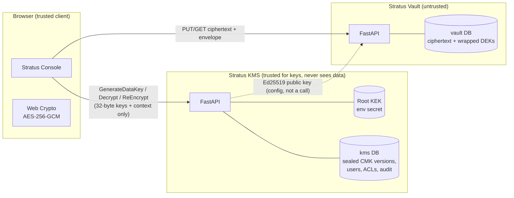
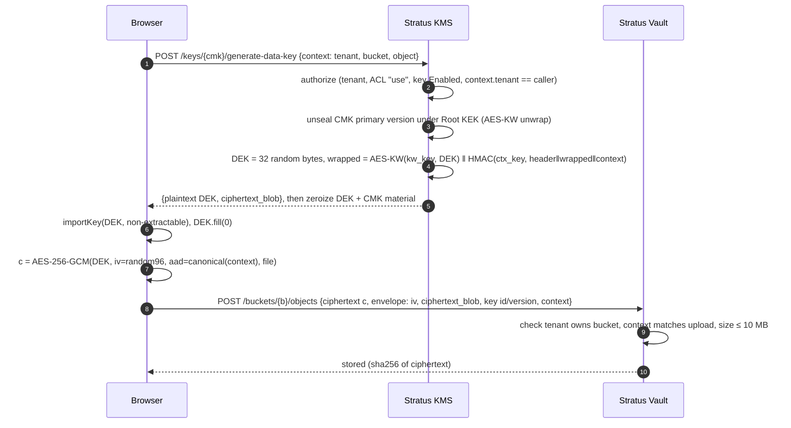
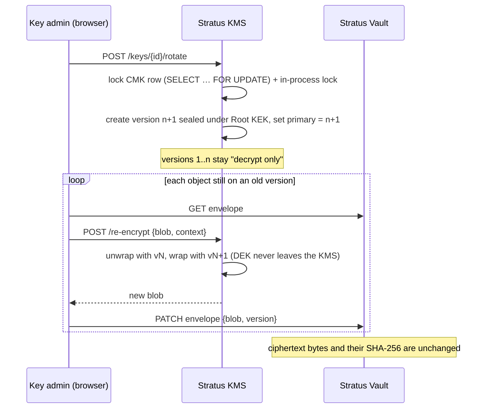

# Architecture

## Components and trust domains



* The Vault holds **no KMS credential** and makes **no call** to the KMS. Re-wrap jobs are orchestrated by the client.
* The KMS and the Vault use **separate databases with separate roles**, so compromising one service's credentials does not expose the other's data.
* Token signing keys live only in the KMS. The Vault receives the public half, so it can check sessions but cannot create them.

## Data flow: upload (plaintext → ciphertext)



## Data flow: download (ciphertext → plaintext)

```mermaid
sequenceDiagram
  autonumber
  participant U as Browser
  participant V as Stratus Vault
  participant K as Stratus KMS
  U->>V: GET object metadata + /body
  V-->>U: ciphertext, iv, ciphertext_blob, context
  U->>K: POST /decrypt {ciphertext_blob, context}
  K->>K: parse blob → cmk id + version; authorize; verify HMAC over context (constant time)
  K->>K: unwrap DEK (AES-KW or RSA-OAEP)
  K-->>U: DEK
  U->>U: import non-extractable, wipe raw bytes, AES-GCM decrypt + verify tag with AAD
```

## Key rotation and re-wrap



## Revocation

```mermaid
stateDiagram-v2
  [*] --> Enabled
  Enabled --> Disabled: disable
  Disabled --> Enabled: enable
  Enabled --> PendingDeletion: schedule deletion (7–30 days; demo allows 0–2 min)
  Disabled --> PendingDeletion: schedule deletion
  PendingDeletion --> Disabled: cancel
  PendingDeletion --> Deleted: window elapses → material nulled (crypto-shred)
  Deleted --> [*]
```



Finer-grained revocation is per user: removing someone from a key's access list makes their next request fail with `AccessDeniedException`.

## Concurrency model

* FastAPI runs synchronous handlers on a thread pool. Each request uses a single database connection, and audit writes reuse it.
* Rotation is serialised by a per-key lock and a database row lock, and `UNIQUE(cmk_id, version)` is the backstop. Two concurrent rotations can never mint the same version (tested in `test_concurrent_data_keys_and_rotation`).
* GenerateDataKey reads the primary version and its material in one transaction, so every issued blob names a version that exists.
* Rate limiting:
  * A token bucket allows 200 burst and 100/s per user.
  * 8 denied calls within 60 s lock the caller out for 30 s.
  * 5 failed sign-ins lock the account for 60 s.

## Ciphertext blob format

```
offset  size  field
0       4     magic "SKB1"
4       1     algorithm (1 = AES-KW, 2 = RSA-2048-OAEP)
5       16    CMK id (UUID bytes)
21      4     CMK version (big-endian)
25      2     wrapped DEK length L
27      L     wrapped DEK (40 bytes for AES-KW, 256 for RSA)
27+L    32    HMAC-SHA256(ctx_key, len‖header‖wrapped‖canonical_context)
```
